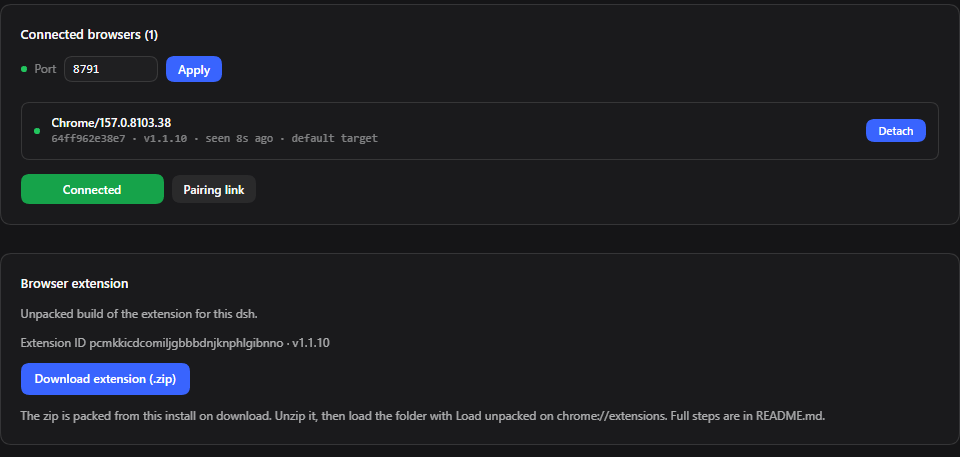

<p align="center">
  <picture>
    <source media="(prefers-color-scheme: dark)" srcset="docs/images/banner-dark.svg">
    
  </picture>
</p>

Browser Bridge is a DeepSeek Harness plugin and a Chromium extension. It lets an
agent drive the browser you are already signed into: open a tab, read it, and act
on it over the DevTools Protocol. It does not start a second browser, copy
cookies, or ask you to paste a token by hand. The extension discovers the host
and pairs with it.

The host provides the plugin page cards and the extension download. Ten tools
cover reading, input, waiting, screenshots, pixel sampling, network and console
observation, and script evaluation.

## Requirements

- DeepSeek Harness 0.2.x.
- Chrome or Edge 116 or newer. Other Chromium browsers work; Firefox does not.
- The extension is loaded unpacked. There is no store listing.

## Install

### 1. Add the plugin

Replace `web` with your DSH profile name.

```sh
dsh plugin --profile web add /absolute/path/to/dsh-browser-bridge
```

The published package is also available:

```sh
dsh plugin --profile web add dsh-bsb
```

The plugin row runs on the host. It listens on port 8791.

### 2. Install the extension

1. Open the DSH Plugins panel, select Browser Bridge, and download the zip from
   the Browser extension card.
2. Unzip it. `manifest.json` must be at the top level of the folder.
3. Open `chrome://extensions` (or `edge://extensions`), turn on Developer mode,
   choose Load unpacked, and select the folder.
4. Pair the extension. Open the extension popup. It scans `127.0.0.1` ports
   8791-8811 and connects to the first host that answers. If the host is on
   another port or another machine, paste the pairing link from the plugin page
   into the popup and press Pair. The plugin page also has a Connect this browser
   button, which pairs the browser that shows the page.

### 3. Confirm the connection

The popup shows Connected, and the plugin page lists the browser under Connected
browsers. The tools are the agent's, not a user command: the agent's first call,
`bsb_browsers`, lists the same browser.

### The plugin page

The plugin page shows the connected browsers, the extension download, and the
pairing link.



## Updating

### Update the plugin

For the npm package, the Plugins panel can update an installed version when a
newer one is available. You can also run:

```sh
dsh plugin --profile web add dsh-bsb@latest
```

For a local checkout, re-run the add command with the path. Then disable and
enable Browser Bridge in the Plugins panel, or restart DSH. The Plugins panel
shows the installed version; `/browser-bridge/api/build` reports the running
build.

### Update the extension

1. Open the Browser Bridge plugin page and download the extension zip again.
2. Unzip it over the folder you loaded in `chrome://extensions`, replacing the
   files. Keep `manifest.json` at the top.
3. In `chrome://extensions`, press Reload on the Browser Bridge card. The
   extension keeps its pairing and reconnects.

The worker also reloads itself when it sees a newer version after the files are
replaced.

## Tools

The plugin registers ten tools for the agent. You do not call them from a shell;
they appear in the agent's tool list.

| Tool | What it does |
| --- | --- |
| `bsb_browsers` | Lists connected browsers, the default target, and whether each one is polling. Start here when a call reports no browser. |
| `bsb_open` | Opens a URL and makes it the tracked tab. The new tab stays in the background unless `activate: true`. |
| `bsb_tabs` | Lists, adopts, reloads, or closes tabs. |
| `bsb_read` | Reads the page. `mode: "text"` returns visible text and interactive elements with `@eN` refs; `"rows"` returns selector matches as structured rows; `"html"` returns one element's `outerHTML`. |
| `bsb_act` | Performs one input action: click, hover, type, set, select, key, wheel, scroll, drag, drop, upload, or `drive` for canvas steering. It also has `forceActive` and `releaseActive` for pages whose frame clock has stopped. |
| `bsb_wait_for` | Waits for a selector, text, URL, enabled control, settled box, JS expression, network request, or a fixed delay. |
| `bsb_capture` | Saves screenshots, selector contact sheets, or a recording to disk and returns file paths for `read_image`. |
| `bsb_pixels` | Samples an element as a colour grid or at exact points. Reads only; useful for canvas boards and maps that a DOM query cannot address. |
| `bsb_observe` | Records the page's own network requests, console messages and exceptions, or samples an element over time. |
| `bsb_eval` | Evaluates JavaScript and returns the value. Runs in a read-only isolated world by default; `world: "main"` opts into the page's world. Also installs document-start scripts. |

Every page tool accepts `browser` and `tabId`; the tools that support child
documents also accept `frame`. Only `bsb_open` and `bsb_tabs use` change the
tracked tab, so two agents can drive two tabs of one browser without retargeting
each other. `bsb_act` performs one action per call. The tool schemas carry the
full parameter lists.

A bundled skill, `browser-bridge`, holds the workflow playbook: tool choice, the
read, act, and wait loop, canvas and WebGL pages, iframes, network debugging, and
recovery. It registers from the skill catalog when the plugin loads.

## Configuration

The plugin row in the profile's `cordis.patch.yml` accepts:

```yaml
config:
  port: 8791
  bind: '0.0.0.0'
  advertise: '192.168.1.20'
```

| Key | Default | Meaning |
| --- | --- | --- |
| `port` | 8791 | Listener port. The extension probes 8791-8811. A port outside that range still works when the pairing link is pasted. |
| `bind` | `0.0.0.0` | Address to listen on. Use `127.0.0.1` for this machine only. |
| `advertise` | auto | Host address written into the pairing link. It is only used when `bind` is a wildcard. Defaults to the first private IPv4. |

`advertise` is for browsers on other machines. The pairing link is
`http://<advertise>:<port>/p/<token>`, and the extension uses that address to
reach the host. Leave it unset when the automatic first private IPv4 is the
address those browsers can reach. Set it when the host has several network
interfaces, a VPN, or a container network, and the guess is wrong. A specific
`bind` already fixes the address, so `advertise` does nothing then.

Port changes made from the plugin page are stored in
`<dsh home>/browser-bridge/settings.json` and outrank the row. Reset removes the
override.

## Troubleshooting

| Symptom | Cause and fix |
| --- | --- |
| Chrome reports "Manifest file is missing or unreadable" when loading the folder. | The selected folder is not the one that contains `manifest.json`. Select the unzipped folder itself, not its parent. |
| The popup says "Not connected" or "Reconnecting". | The host is not running, the saved endpoint is stale, or the worker is suspended. Open the popup to retry; check the host is running from the plugin page; if the port changed, copy the pairing link and paste it in the popup. |
| The Pair button turns red and shakes after a paste. | The text is not a pairing link, or the host did not answer. Copy the pairing link again from the plugin page; check the host is running; for a LAN browser, allow the port through the firewall and check `advertise`. The extension console names the exact cause. |
| The plugin page says "No browsers yet." | The extension is not paired, or its worker is suspended. Open the popup to wake it; check `chrome://extensions` for errors and reload the extension. |

## License

MIT. See [LICENSE](LICENSE).
