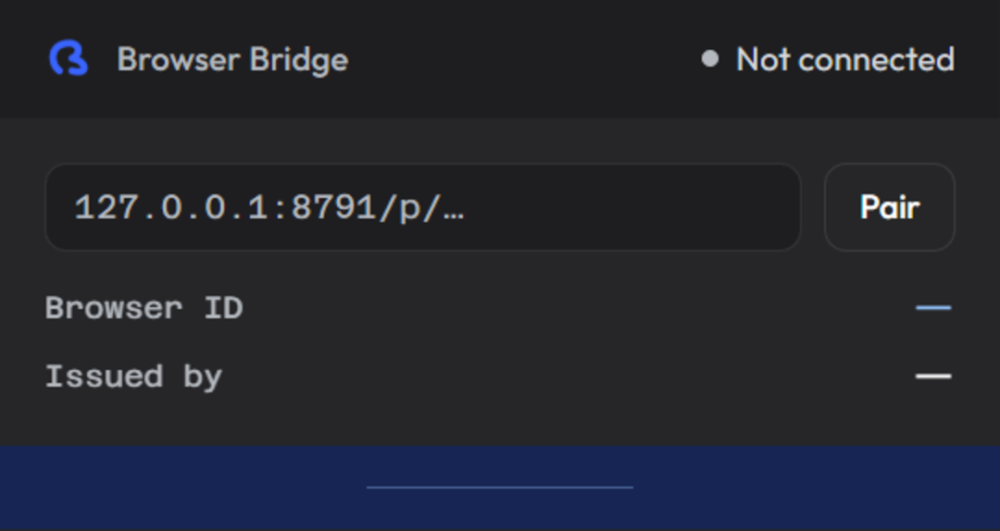
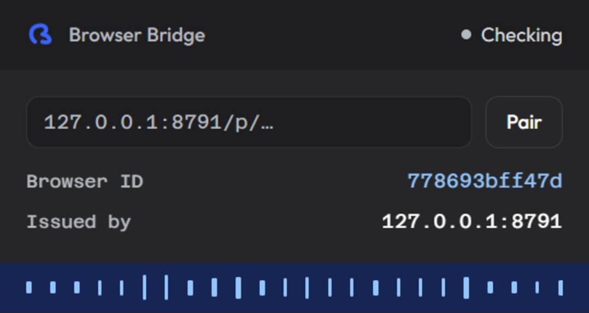
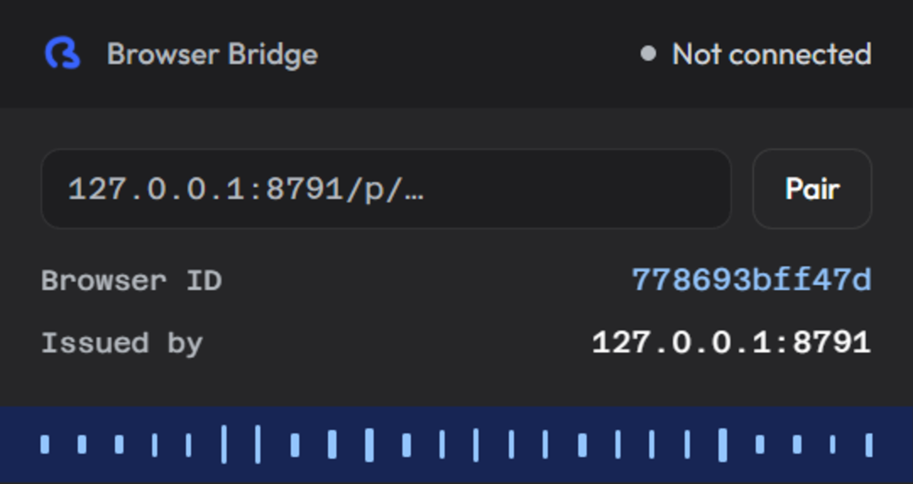
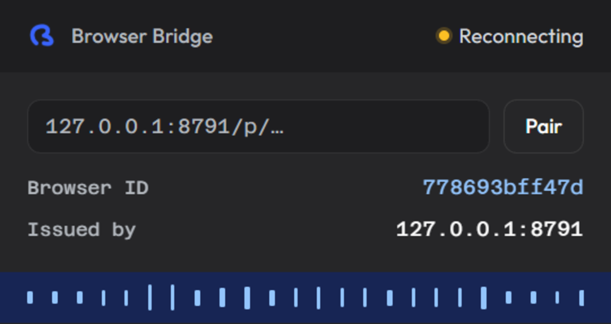
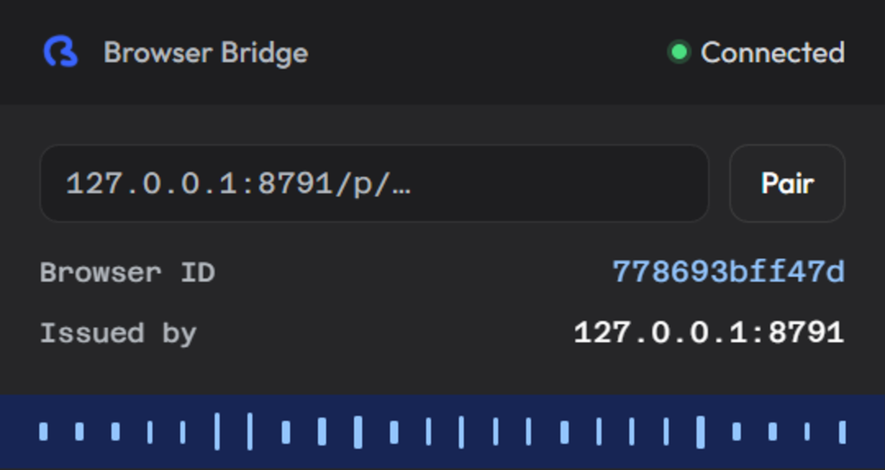
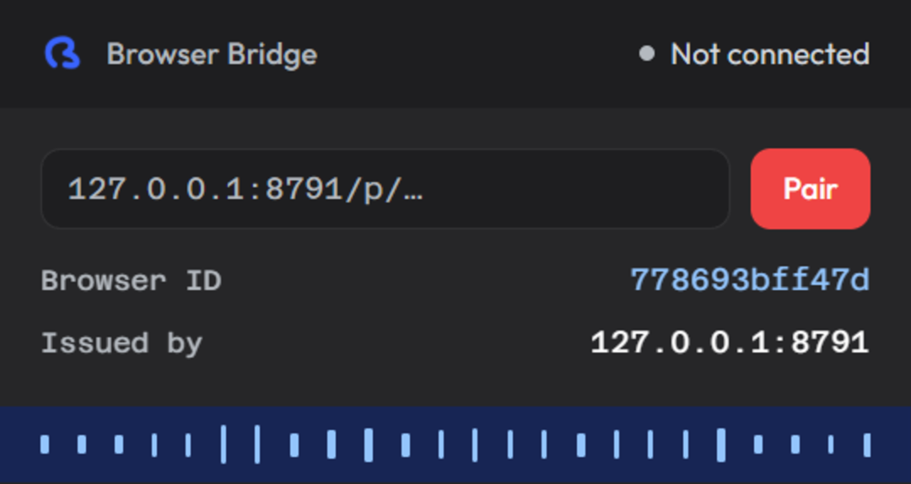

<p align="center">
  <picture>
    <source media="(prefers-color-scheme: dark)" srcset="docs/images/banner-dark.svg">
    
  </picture>
</p>

<p align="center">
  <a href="https://github.com/C4Hy0/dsh-browser-bridge/actions/workflows/ci.yml"></a>
</p>

A DeepSeek Harness plugin and a Chromium extension that let an agent drive the
browser you are already signed into. The agent opens a tab, reads it, and acts on
it through the DevTools Protocol. It does not start a second browser, copy
cookies, or ask you to paste a token by hand: the extension discovers the local
host plugin and pairs with it.

Ten tools cover reading, input, waiting, screenshots, pixel sampling, network and
console observation, and script evaluation. The host plugin listens on one local
port and serves the extension zip and a small dashboard on the plugin page.

## Requirements

- DeepSeek Harness with plugin rows. Both webserver route contracts used by DSH
  0.2.x are supported.
- Chrome or Edge 116 or newer. Other Chromium forks work; Firefox does not.
- The extension is loaded unpacked. There is no store listing and no `.crx`.

## Install

### 1. Add the plugin

```sh
dsh plugin --profile web add /absolute/path/to/dsh-browser-bridge
```

Or install the published package:

```sh
dsh plugin --profile web add dsh-bsb
```

The row is host-only. It listens on `127.0.0.1:8791` by default and registers the
ten tools.

### 2. Install the extension

1. In the DSH sidebar, open Plugins, then select Browser Bridge under Installed
   plugins. The page has a card titled Browser extension, with the extension ID,
   its version, and a Download extension (.zip) button. The host packs the zip
   from `extension/` when you click, so there is no build step. The plugin page
   screenshot under Screenshots shows the card.
2. Unzip the download. The folder must contain `manifest.json` at its top level.
3. Open `chrome://extensions` (or `edge://extensions`), turn on Developer mode,
   choose Load unpacked, and select that folder.
4. Pair. The popup scans `127.0.0.1` ports 8791-8811 and connects to the first
   host that answers. For a host on another port, paste the pairing link from the
   plugin page into the popup field and press Pair.

`bsb_browsers` then lists the browser. The label is the product token from the
user agent plus the full build, for example `Chrome/157.0.8103.38`.

## Updating

Extension changes: replace the files in the folder you loaded and press reload on
the extension card in `chrome://extensions`. Host changes: toggle the bundle or
restart DSH, then check `/browser-bridge/api/build`, which reports the build that
is actually running.

## Screenshots

The plugin page in DSH, showing connected browsers and the extension download:


### Popup states

The lamp and the word beside it carry the connection state. A failed pairing
turns the Pair button red until the field changes.

The band at the bottom encodes the browser id. With no id yet, the strip is a
single quiet rule instead of a pattern.

| State | Preview |
| --- | --- |
| Never connected, before an identity exists (flat band) |  |
| Checking, before the first status read |  |
| Not connected |  |
| Reconnecting, amber lamp |  |
| Connected, green lamp |  |
| Pairing failed, red button |  |

## Tools

| Tool | What it does |
|---|---|
| `bsb_browsers` | Lists connected browsers, the default target, and whether each one is polling. Start here when a call reports no browser. |
| `bsb_open` | Opens a URL and makes it the tracked tab. The new tab stays in the background unless `activate: true`. |
| `bsb_tabs` | Lists, adopts, reloads, or closes tabs. |
| `bsb_read` | Reads the page. `mode: "text"` returns visible text, interactive elements with `@eN` refs, and viewport data; `"rows"` returns selector matches as structured rows; `"html"` returns one element's `outerHTML`. |
| `bsb_act` | Performs one input action: click, hover, type, set, select, key, wheel, scroll, drag, drop, upload, or `drive` for canvas steering. `key` takes a named key, held keys, `steps`, or `text` to send one real key event per character. It also has `forceActive` and `releaseActive` for pages whose frame clock has stopped. |
| `bsb_wait_for` | Waits for a selector, text, URL, enabled control, settled box, JS expression, network request, or a fixed delay. |
| `bsb_capture` | Saves screenshots, selector contact sheets, or a recording to disk and returns file paths for `read_image`. |
| `bsb_pixels` | Samples an element as a colour grid or at exact points. Reads only; useful for canvas boards and maps that a DOM query cannot address. |
| `bsb_observe` | Records the page's own network requests, console messages and exceptions, or samples an element over time. |
| `bsb_eval` | Evaluates JavaScript and returns the value. Runs in a read-only isolated world by default; `world: "main"` opts into the page's own world. Also installs document-start scripts (`installOnNewDocument`) that run before every new document of the tab. |

Every page tool accepts `frame` (a frame id, URL substring, or index) and
`browser` (a browser id, id prefix, or label substring). Page tools also accept
`tabId` to target one tab for a call; only `bsb_open` and `bsb_tabs use` change
the tracked tab, so two agents can drive two tabs of one browser without
retargeting each other. `bsb_act` performs one action per call. The tool schemas
carry the full parameter lists.

A bundled skill, `browser-bridge`, holds the workflow playbook: tool choice, the
read/act/wait loop, canvas and WebGL pages, iframes, network debugging, and
recovery. It registers from the skill catalog when the plugin loads, so there is
no project skill file to copy.

## Configuration

The row in `cordis.patch.yml`:

```yaml
config:
  port: 8791
  bind: '0.0.0.0'
```

| Key | Default | Effect |
|---|---|---|
| `port` | 8791 | Listener port. The extension probes 8791-8811 on connect. A port outside that range still works when the pairing link is pasted. |
| `bind` | `0.0.0.0` | Address to listen on. Use `127.0.0.1` for this machine only. |
| `advertise` | auto | Address written into the pairing URL. Defaults to the first private IPv4. |

Port changes made from the plugin page are stored in
`<dsh home>/browser-bridge/settings.json` and outrank the profile config. Reset
removes the override.

## Troubleshooting

| Symptom | Cause and fix |
|---|---|
| "Manifest file is missing or unreadable" | You selected a folder above the one that contains `manifest.json`. |
| "Pairing failed. Check the link and try again." | The link did not reach a bridge. Open `/discover` in a tab, check the port, and for a LAN peer check the firewall. The extension service worker console shows the specific error. |
| Remote browser cannot find the bridge | Expected. The sweep only probes `127.0.0.1`; paste the pairing link. |
| `bsb_browsers` is empty | No extension is polling. Reload the extension and check its card for errors. |
| "browser is not connected" | The worker was suspended or the browser closed. It reconnects on the next alarm or when the popup opens. |
| Dev routes return 404 | The dev routes are always registered; a 404 means the plugin is not loaded or the port is wrong. Check `/browser-bridge/api/build`. |

## Compatibility

- DSH 0.2.x. Both known webserver route contracts are covered and tested.
- Chrome or Edge 116 or newer. The extension uses Manifest V3 and
  `chrome.debugger`.
- Unpacked install only. Chrome rejects off-store `.crx` files with
  `CRX_REQUIRED_PROOF_MISSING`, so the plugin does not produce one.

## License

MIT. See [LICENSE](LICENSE).
